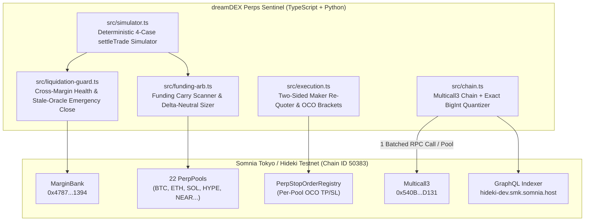

# dreamDEX Perps Sentinel — Automated Funding-Rate Arbitrage, Liquidation Guard & Risk-Managed Execution Agent on Somnia Testnet (Chain 50383)

[](https://app.testnet.dreamdex.io)
[](https://www.npmjs.com/package/@somnia-chain/markets-sdk)
[](./LICENSE)

**dreamDEX Perps Sentinel** is an open-source, production-grade quantitative execution and risk-management engine built on **dreamDEX Perpetuals** (`@somnia-chain/markets-sdk` & `@dreamdex-bot-kit/perp-core`) on **Somnia Tokyo / Hideki Testnet (`chainId 50383`)**.

It combines:
1. **Cross-Market Funding-Rate Arbitrage & Delta-Neutral Position Sizer** (`src/funding-arb.ts`)
2. **Multi-Stage Cross-Margin Liquidation Guard & Stale-Oracle Emergency De-Leverager** (`src/liquidation-guard.ts`)
3. **Risk-Managed Execution, Two-Sided Maker Re-Quoter & OCO Stop-Bracket Engine** (`src/execution.ts`)
4. **Deterministic Cross-Margin `MarginBank.settleTrade` Simulator** (`src/simulator.ts`)
5. **Companion Zero-Dependency Python Quant & Analytics SDK** (`python/dreamdex_sentinel/`)
6. **Track 1 Technical Audit & Surgical Fixes (`feedback/`)** — 8 reproducible bug reports across `@dreamdex-bot-kit/perp-core`, `strategies/perp-*`, `@somnia-chain/markets-sdk`, and official docs, all fixed and regression-tested (`100%` passing).

---

## Who It Is For & What Problem It Solves

Quant traders, market makers, and automated keepers building on **dreamDEX Perpetuals** need:
- **Exact Fixed-Point & Grid Arithmetic**: Prices (`1e18` quote units) and quantities (`baseDecimals` from `6` to `24` on `NEAR-PERP`) must be quantized to each pool's `tickSize` and `lotSize` without IEEE-754 floating-point overflow or 9-decimal truncation.
- **Reliable Emergency De-Leveraging During Oracle Outages & Margin Calls**: When a market's oracle mark goes stale (`priceable: false`) or an account enters `MarginCall` with resting Take-Profit / Maker orders on the reducing side, naive close helpers either abort early or revert with `InsufficientMarginForOrder` because `PerpPool._computeLockAmount` subtracts resting reducing orders from `_reducingCapacity`.
- **Incremental Carry Scaling & Delta-Neutral Hedging**: Automatically scans all **22 live perp markets** on Somnia Hideki (`chainId 50383`) via batched `Multicall3` reads, computes net funding carry APR after taker/maker fees and adverse mark-to-entry gap reserves, and sizes delta-neutral pairs or incremental carry slices up to `MAX_POSITION`.

---

## 1-Command Quickstart

```bash
# 1. Install dependencies
npm install

# 2. Run the TypeScript unit & regression test suite (Vitest)
npm test

# 3. Run the Python companion unit test suite (unittest)
npm run test:python

# 4. Run the live Somnia Hideki Testnet (Chain 50383) scanner & strategy demo
npm run demo

# 5. Run the side-by-side Track 1 Bug Reproduction & Fix Verification suite
npm run audit
```

---

## Architecture & Module Overview



| File | Description |
| :--- | :--- |
| [`src/chain.ts`](./src/chain.ts) | Exports `SOMNIA_HIDEKI_TESTNET_ADDRESSES`, `makeSentinelChain()` with `contracts.multicall3` configured (`10x` RPC reduction in `getPerpState()`), and exact `BigInt` unit/tick/lot quantizers (`toRawExact`, `fromRawExact`, `alignPrice`, `alignQuantity`, `scalePriceByBps`). |
| [`src/funding-arb.ts`](./src/funding-arb.ts) | Normalizes 8h `1e18` funding rates into annualized APR, computes instantaneous mark-to-index premium (`ppm`), evaluates net carry after fees, scales positions in `sliceUsdso` increments up to `maxPositionUsdso`, computes true effective margin requirements (`computeEffectiveMarginRequirement`), and constructs lot-aligned delta-neutral pairs (`buildDeltaNeutralPair`). |
| [`src/liquidation-guard.ts`](./src/liquidation-guard.ts) | Exact `BigInt` port of `perpLiquidationPrice` (with moving `10000 ∓ mmBps` factor), cross-margin `healthRatio` staging (`HEALTHY`, `WATCH`, `SCALE_DOWN`, `EMERGENCY_FLATTEN`), and `planEmergencyDeleverage()` with stale-oracle fallback and pre-close resting-order cancellation. |
| [`src/execution.ts`](./src/execution.ts) | `shouldRequoteMaker()` (fixes missing-leg starvation after `PostOnlyWouldCross`), `buildMakerQuotes()`, `buildOcoBracket()` (tick-aligned OCO Take-Profit & Stop-Loss triggers), and `evaluateWatchedExit()`. |
| [`src/simulator.ts`](./src/simulator.ts) | Deterministic cross-margin simulator modeling `MarginBank.settleTrade` (`OPEN`, `INCREASE` with floored VWAP, `REDUCE/CLOSE` with floored realized PnL, `FLIP`, and `divCeilSigned` whole-position funding settlement). |
| [`src/cli.ts`](./src/cli.ts) | 1-command CLI (`npm run demo`) connecting to live Somnia Hideki (`chainId 50383`), scanning all 22 live perp markets, inspecting live on-chain `BTC-PERP` holders, and running the full strategy + risk-guard pipeline. |
| [`python/dreamdex_sentinel/`](./python/dreamdex_sentinel/) | Zero-dependency Python companion package (`quant.py`, `client.py`) and test suite (`python/tests/test_sentinel.py`). |

---

## Track 1 — Feedback & Bug Hunt Reports (`feedback/`)

All 8 bug reports discovered during our audit of `@dreamdex-bot-kit/perp-core`, `strategies/perp-*`, `@somnia-chain/markets-sdk`, and the official Perps documentation are documented in [`feedback/`](./feedback/README.md) and reproduced via `npm run audit`:

| ID | Report File | Severity | Target Component | Summary of Root Cause & Fix in Sentinel |
| :--- | :--- | :---: | :--- | :--- |
| **BUG-01** | [`feedback/01-close-position-stale-oracle-and-resting-orders.md`](./feedback/01-close-position-stale-oracle-and-resting-orders.md) | **Critical / Major** | `perp-core/src/orders.ts` (`closePosition`), `perp-guard` | `closePosition()` calls `previewPerpClosePnl` and returns `{ sent: false, filled: 0n }` when `!preview.priceable`, breaking `perp-guard` during oracle outages; also omits cancelling resting reducing orders so `_computeLockAmount` treats emergency closes as position-increasing orders. Fixed in `planEmergencyDeleverage()`. |
| **BUG-02** | [`feedback/02-toraw-precision-truncation-and-crash.md`](./feedback/02-toraw-precision-truncation-and-crash.md) | **Major** | `perp-core/src/markets.ts` (`toRaw`) | `toRaw(human, decimals)` uses `human.toFixed(Math.min(decimals, 9))`, silently zeroing digits past 9 decimal places (`NEAR-PERP` has 24 decimals; `toRaw(1e-10, 18) === 0n`) and crashing with `SyntaxError` on `>= 1e21`. Fixed in `toRawExact()`. |
| **BUG-03** | [`feedback/03-ieee754-float-overflow-price-corruption.md`](./feedback/03-ieee754-float-overflow-price-corruption.md) | **Major** | `orders.ts`, `perp-starter`, `perp-maker`, `perp-funding` | 7 call sites compute `BigInt(Math.round(price * 1e18))`, overflowing IEEE-754 `Number.MAX_SAFE_INTEGER` by `8,400,000x` on `BTC-PERP` (`$75,821.33` drifts by `+9,109,504` wei) and corrupting tick alignment. Fixed in `scalePriceByBps()` and `buildOcoBracket()`. |
| **BUG-04** | [`feedback/04-perp-funding-unreachable-max-position-scaling.md`](./feedback/04-perp-funding-unreachable-max-position-scaling.md) | **Major** | `strategies/perp-funding/src/index.ts` | `else if (!position && worthHolding && me)` wraps `if (held >= MAX_POSITION)`, making `held` always `0` inside the branch and preventing `perp-funding` from ever scaling past its first `$50` slice up to `MAX_POSITION` (`$200`). Fixed in `computeCarrySlice()`. |
| **BUG-05** | [`feedback/05-perp-maker-missing-leg-never-requotes.md`](./feedback/05-perp-maker-missing-leg-never-requotes.md) | **Major** | `strategies/perp-maker/src/index.ts` | Checking `(resting.bid || resting.ask)` instead of verifying all allowed legs are resting causes `perp-maker` to sleep forever on a flat mark if one leg was skipped due to `PostOnlyWouldCross`. Fixed in `shouldRequoteMaker()`. |
| **BUG-06** | [`feedback/06-makechain-missing-multicall3-rpc-amplification.md`](./feedback/06-makechain-missing-multicall3-rpc-amplification.md) | **Critical / Major** | `@somnia-chain/markets-sdk/chains` (`hidekiTestnet`), `perp-core/src/config.ts` (`makeChain`) | `hidekiTestnet` hardcodes `multicall3: 0x540B091b608f54E603c5dC19F6b2d955e1d2D131` which has **0 bytes of bytecode (`0x`)** on Chain `50383`, crashing `getPerpState()` with `aggregate3 returned no data ("0x")`; meanwhile `perp-core` `makeChain()` omits `multicall3` (10x RPC amplification). Fixed in `makeSentinelChain()` using the live deployed Multicall3 (`0xcA11bde05977b3631167028862bE2a173976CA11`, 7,618 bytes). |
| **BUG-07** | [`feedback/07-preflight-underestimates-effective-margin.md`](./feedback/07-preflight-underestimates-effective-margin.md) | **Major** | `perp-core/src/margin.ts` (`preflight`) | `preflight()` checks `NOTIONAL / LEVERAGE` without clamping to the market's max leverage (`initialMarginBps` / `effectiveImfBps`), account-level `getMaxLeverage` cap (`leverageSurcharge`), or adverse mark-to-entry gap. Fixed in `computeEffectiveMarginRequirement()`. |
| **BUG-08** | [`feedback/08-docs-and-lockfile-mismatch.md`](./feedback/08-docs-and-lockfile-mismatch.md) | **Minor / Docs** | `docs/developers/perps-testnet`, `docs/trading/perps-testnet`, `package-lock.json` | Root `package-lock.json` locks `@somnia-chain/markets-sdk@0.30.0` where `SOMNIA_HIDEKI_TESTNET_ADDRESSES` is `undefined`; `docs/trading/perps-testnet` lists outdated IM/MM/MaxLev across 12 markets (`BTC/ETH/SOL/HYPE` are `40x`, not `20x`/`10x`) and omits `ADLT-PERP`; root `npm run build` omits `perp-core`. |

---

## Live Somnia Tokyo / Hideki Testnet (`chainId 50383`) Deployment Reference

| Contract / Resource | Address / Endpoint |
| :--- | :--- |
| **Network / Chain ID** | Somnia Tokyo / Hideki Testnet (`50383`) |
| **JSON-RPC Endpoint** | `https://api.hideki2.infra.testnet.somnia.network` |
| **WebSocket Endpoint** | `wss://api.hideki2.infra.testnet.somnia.network/ws` |
| **GraphQL Indexer** | `https://hideki-dev.smk.somnia.host/v1/graphql` |
| **MarginBank** | `0x478769E1177C0773c43A593DCCc4Ad15F15F1394` |
| **Collateral Token (`USDso`)** | `0xed7993A74dAe1e6656B704A424DcD8711aAf4F72` (18 decimals) |
| **PerpPoolFactory** | `0xE631fAEE547baeE07353E290f0562ea67d856560` |
| **LiquidationEngine (Proxy)** | `0xA66d3C24Ad4a389d863846905D8173e1017e9F4D` |
| **InsuranceFund** | `0x50826894D47C6D4f3BeA38BFDC7Dc5c5be171b80` |
| **VoucherDistributor** | `0x2ACD9EFdA721450906bfE1bef3edE269636E42C4` |
| **OperatorPermissionsRegistry** | `0x6B2FbfeD328FF5F20C0BE7D3C3437613aFFE8D3a` |
| **Multicall3** | `0xcA11bde05977b3631167028862bE2a173976CA11` |
| **`BTC-PERP` Pool (`40x`)** | `0x3b8aa132d05471e4c9268a4d66541fa4a2232023` |
| **`ETH-PERP` Pool (`40x`)** | `0x052889598b4d7ffcf61aa04fbdb3148a349257b9` |
| **`SOL-PERP` Pool (`40x`)** | `0xdf3b47908c5530aa1c8a8652651f6a64c291ec47` |
| **`HYPE-PERP` Pool (`40x`)** | `0xf08ba129224143ac9a2bdbe756acda413b0ef168` |
| **`NEAR-PERP` Pool (`20x`, 24 dec)** | `0x660b88318c7d4aa39a2ab98f942fb9cecf7a6ca3` |

---

## X posts

- Builder announcement & technical thread tagging **@DreamDEXSomnia**:
  > Built **dreamDEX Perps Sentinel** on @DreamDEXSomnia (Somnia Tokyo/Hideki Testnet, Chain 50383)!
  > - Automated Funding-Rate Arbitrage & Delta-Neutral Sizer across all 22 on-chain PerpPools
  > - Multi-stage Cross-Margin Liquidation Guard & Stale-Oracle Emergency De-leverager
  > - 8 SDK/Bot-Kit bug reports + surgical fixes (`Multicall3` 10x RPC batching, 24-dec `toRawExact`, stale-mark closes)
  > Repo: https://github.com/LBCron/dreamdex-perps-sentinel #DreamDEX #Somnia #Perps

---

## License

MIT License — Copyright (c) 2026 `@LBCron` (`LBCron <ronanchenlopes@gmail.com>`).
